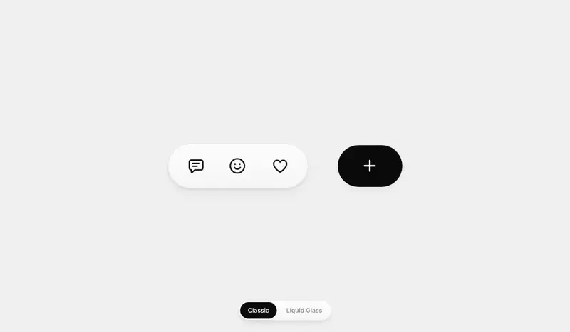

# Response Bar interaction

A reaction pill that springs open into a reply field, with the **+** button docking into its end as the send button. Tap the smiley for a scrolling emoji panel, tap the heart for an X-style like burst, and send a reply to watch it float up. A switch at the bottom moves between Classic and Liquid Glass.

<p align="center">
  
</p>

<p align="center"><a href="docs/demo.mp4">Watch as a video</a></p>

## Tech stack

- React 19
- Vite 8
- Tailwind CSS 4
- CSS transitions with a spring curve in `linear()`, keyframes and the Web Animations API, no animation library
- Inline SVG

## Run

```bash
npm install
npm run dev
```
